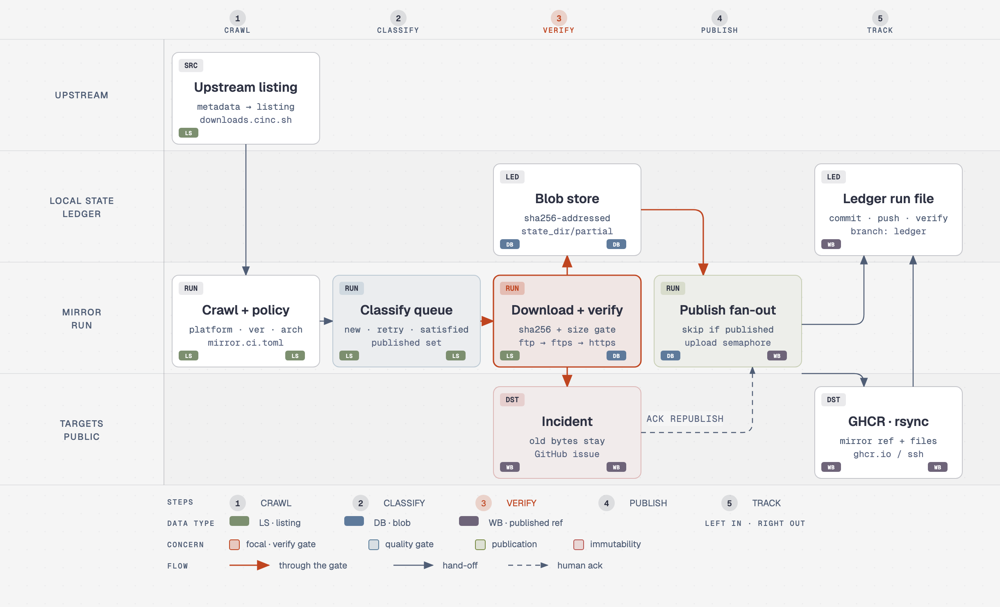

# Cinc Mirror


This repository mirrors Cinc packages. Metadata is read from downloads.cinc.sh /
ftp.osuosl.org; every package is verified against its published hash and then
published to GHCR as OCI artifacts, and optionally to an rsync target — roughly
what Homebrew does for bottles.

The mirror is a single Rust binary, built from this repository. It replaces the
former shell + ORAS + curl scripts: the crawl, download, verification,
publication and repair paths are one program, and every observation is recorded
in a durable ledger committed back to this repository.



*One run end to end, including the branch that matters most: a hash change is
held as an immutable incident until an operator acknowledges it. The
[HTML version](docs/cinc-mirror-workflow.html) is the same figure at full size.*

## Trademark / Remarks

This project is neither affiliated nor approved by Progress Chef and/or the Cinc community project. Use at your own risk. Feel free to open issues but don't expect a SLA. Service may stop/break at any time. Solaris? AIX? 10 year old OS versions? Sorry, won't work.

## Usage/Installation

### Docker example for the impatient

Try it in a throwaway container — nothing on your host changes, everything dies
with `--rm`:

```bash
docker run --rm -it debian bash -lc '
  set -o pipefail
  apt-get update &&
  apt-get install -y curl &&
  curl -sSL https://cinc-mirror.github.io/install.sh | bash -s -- -P cinc-auditor
  exec bash
'
```

Inside the container you are root, so no `sudo`; `exec bash` keeps the shell open
after the install so you can run `cinc-auditor version`. Swap `-P cinc-auditor`
for any other product from the table below. Note that Debian's `bash -lc` starts
in `/`, so carry on with `cd /root` if you want a writable home.

The installers from https://github.com/cinc-mirror/cinc-mirror.github.io replace
https://omnitruck.cinc.sh/install.sh and https://omnitruck.cinc.sh/install.ps1:
metadata still comes from cinc.sh, only the packages come from ghcr.io. In the
metadata dump the upstream `url` line is followed by
`mapped to cinc-mirror url: ghcr.io/rmoriz/cinc-mirror/<project>@sha256:<digest>`,
so the mirror address is visible before anything is fetched; the blob is pulled
from there and the installer falls back to the upstream URL only if the mirror
cannot serve it.

`-P` (POSIX) and `-project` (PowerShell) name the product. Without it, `cinc`
is installed.

| `-P` / `-project` | installs |
| --- | --- |
| `cinc` (default) | Cinc Client |
| `cinc-auditor` | Cinc Auditor |
| `cinc-foundation` | Cinc Foundation |
| `cinc-server` | Cinc Server (Linux/x86_64 only) |
| `cinc-workstation` | Cinc Workstation |
| `omnibus-toolchain` | the Omnibus build toolchain |

Linux and macOS:

```bash
# Cinc Client (default)
curl -sSL https://cinc-mirror.github.io/install.sh | sudo bash

# Cinc Auditor
curl -sSL https://cinc-mirror.github.io/install.sh | sudo bash -s -- -P cinc-auditor

# Cinc Workstation
curl -sSL https://cinc-mirror.github.io/install.sh | sudo bash -s -- -P cinc-workstation

# Cinc Server
curl -sSL https://cinc-mirror.github.io/install.sh | sudo bash -s -- -P cinc-server

# Cinc Foundation
curl -sSL https://cinc-mirror.github.io/install.sh | sudo bash -s -- -P cinc-foundation

# Omnibus toolchain
curl -sSL https://cinc-mirror.github.io/install.sh | sudo bash -s -- -P omnibus-toolchain
```

`cinc-server` exists only for Linux/x86_64 — no macOS, Windows or arm64 build —
the server example needs an x86_64 host. All other products build for several
platforms and the installer picks the matching package.

Windows PowerShell (elevated):

```powershell
# Cinc Client
. { iwr -useb https://cinc-mirror.github.io/install.ps1 } | iex; install -project cinc

# Cinc Auditor
. { iwr -useb https://cinc-mirror.github.io/install.ps1 } | iex; install -project cinc-auditor

# Cinc Workstation
. { iwr -useb https://cinc-mirror.github.io/install.ps1 } | iex; install -project cinc-workstation

# Cinc Foundation
. { iwr -useb https://cinc-mirror.github.io/install.ps1 } | iex; install -project cinc-foundation

# Omnibus toolchain
. { iwr -useb https://cinc-mirror.github.io/install.ps1 } | iex; install -project omnibus-toolchain
```

Both installers accept the upstream flags, e.g. `-v 26.4.0` / `-version 26.4.0`
to pin a version, `-c current` for the current channel's integration builds, and
`-d /tmp/dl` / `-f file` (POSIX) or `-download_directory` / `-filename`
(PowerShell) to choose where the package is saved before it is installed.
`-s once` (POSIX) skips the install when the project is already present, and
`-WhatIf` (PowerShell) reports what would be downloaded and installed. `install`
is the upstream-compatible alias for `Install-Project`, so
`install -project cinc-workstation -channel current` works too.

**Requirements:**
- `curl` must be installed for the POSIX installer; the mirror fetch always uses
  it, even when metadata came in over `wget`
- The PowerShell installer needs an elevated shell because it installs the
  `.msi` via `msiexec`. The mirrored `.msi` packages can also be downloaded and
  installed directly (see [Windows](#windows)).
- The mirror follows the current major of each product, so older majors come
  from upstream once the installer falls back.


## Build from source

Requirements: Rust 1.89 or newer. `rsync` is needed only when an rsync target is
configured; OCI-only operation does not use it.

```bash
cargo build --release
./target/release/cinc-mirror --help
```

The test suite runs without network access:

```bash
cargo test
```

## Configuration

The mirror reads `mirror.toml` from the working directory, or the file given
with `--config`. The file is git-ignored and should be mode `0600`. It never
contains credentials: a target names an auth mode and the secret is read from
the environment or a key file at use time. `auth = "docker"` also reads plain
`auths` entries from `~/.docker/config.json`, but it does not run credential
helpers such as Docker Desktop's `desktop` helper.

A commented, ready-to-edit example that publishes to GHCR is in
`mirror.toml.example`; copy it to `mirror.toml`.

Every project is an explicit policy. Version bounds, globs, platforms, platform
versions and architectures narrow what is crawled; `all_versions` and `"*"`
widen it. A single major glob such as `versions = ["19.*"]` follows the current
major line only and is what every policy in `mirror.ci.toml` uses.

```toml
state_dir = "~/.local/state/cinc-mirror"
concurrency = 4
upload_concurrency = 2
max_bandwidth = "0"                 # e.g. "40MiB/s"; 0 = unlimited
transport = ["ftp", "ftps", "https"] # payload ladder, in order
metadata_transport = "https"
min_version = "18"

[[projects]]
id = "cinc-stable"
project = "cinc"
channel = "stable"
min_version = "19.0.0"
platforms = ["debian", "ubuntu", "el"]
arches = ["amd64", "arm64"]

[projects.platform_versions]
debian = ["12", "13"]

[[projects]]
id = "omnibus-toolchain"
project = "omnibus-toolchain"
channel = "stable"
all_versions = true
platforms = "*"
arches = "*"

[ledger]
branch = "ledger"
remote = "origin"

[[targets]]
name = "ghcr"
kind = "oci"
registry = "ghcr.io"
namespace = "<owner>/cinc-mirror"
auth = "basic"

[[targets]]
name = "rsync"
kind = "rsync"
url = "ssh://mirror@backup.example.org/srv/cinc-mirror"
auth = "ssh-key"
identity_file = "~/.ssh/id_ed25519"
```

The GHCR target reads `CINC_MIRROR_GHCR_USER` and
`CINC_MIRROR_GHCR_PASSWORD` (or `password_file`). With the GitHub CLI:

```bash
export CINC_MIRROR_GHCR_USER="$(gh api user --jq .login)"
export CINC_MIRROR_GHCR_PASSWORD="$(gh auth token)"
```

Use `gh auth refresh -s write:packages` if the token lacks the scope.
The binary also loads `.env` (or the legacy `config.env`) from the working
directory before reading credentials, so the same names can live in a
git-ignored file:

```bash
cp .env.example .env && chmod 600 .env
```

Variables already present in the environment are not overridden.
`CINC_MIRROR_ENV_FILE` can name a different file.

`mirror.ci.toml` keeps `auth = "docker"` because the workflow writes a plain
`auths` entry from `GITHUB_TOKEN`.

`mirror.ci.toml` is the committed configuration the scheduled workflow uses; it
mirrors all six upstream projects, but only the current major line of each:
`versions = ["19.*"]` and so on, so every minor and bug release of that major is
mirrored and older majors are left alone. A new upstream major needs a one-word
edit there. `omnibus-toolchain` is the build toolchain rather than a Cinc
product, and its Windows formats collide under one descriptive tag, so it is
listed under `[incident] ignore_arch_collisions` (see below).

When adding a new project, the GHCR package is private by default. Make it
public once under **Package settings → Change package visibility**, e.g.
https://github.com/users/rmoriz/packages/container/package/cinc-mirror%2Fcinc-workstation

Also link the package to this repository with the **Write** role under
**Package settings → Manage Actions access**, otherwise the workflow's
`GITHUB_TOKEN` gets `permission_denied: write_package` even though it has
`packages: write`. The scheduled workflow links packages it creates itself; a
package created outside Actions must be linked by hand.

## Commands

Run `cinc-mirror <command> --help` for the full flag set. Global options are
`--config <FILE>`, `--allow-unleased` and `--log-format text|json`.

- `plan` — estimate a run without downloading package bytes:
  `cinc-mirror plan --everything --json`
- `mirror` — crawl upstream and publish every new artifact:
  `cinc-mirror mirror --everything --limit 50 --gc-after`
- `backfill` — fill historical versions that are not mirrored yet:
  `cinc-mirror backfill --everything --limit 50`
- `verify` — re-hash and compare known publications (a deterministic sample or
  the local store): `cinc-mirror verify --sample 200` or
  `cinc-mirror verify --deep`
- `repair` — re-publish or re-fetch artifacts that need repair:
  `cinc-mirror repair --target rsync`, optionally bounded with `--project`
  (repeatable) and `--limit`
- `prune` — delete publications the policies no longer select, without
  downloading or publishing: `cinc-mirror prune --dry-run`, then
  `cinc-mirror prune` bounded with `--target` (repeatable oci targets),
  `--project` and `--limit`
- `incidents` — inspect and acknowledge integrity incidents:
  `cinc-mirror incidents list`, `cinc-mirror incidents show <id>`,
  `cinc-mirror incidents ack <id> [--republish]`
- `ledger bootstrap` — rebuild ledger rows from an existing mirror:
  `cinc-mirror ledger bootstrap`
- `ledger pull` — fetch the ledger branch: `cinc-mirror ledger pull`
- `ledger push` — push the ledger branch: `cinc-mirror ledger push`
- `ledger compact` — fold event segments into a snapshot:
  `cinc-mirror ledger compact`
- `ledger gc` — garbage-collect superseded ledger data:
  `cinc-mirror ledger gc`
- `ledger export` — export ledger rows: `cinc-mirror ledger export`
- `targets` — inspect configured targets: `cinc-mirror targets list`,
  `cinc-mirror targets check`
- `config check` — validate the configuration without network access:
  `cinc-mirror config check` (add `--probe` to test auth and connectivity)

## The ledger branch

The ledger lives on the `ledger` branch of this repository and is cloned into
`<state_dir>/ledger-repo`. It records what was observed, published, verified,
repaired and reported — hashes, sizes, references, events and incidents. It
never contains package bytes. Do not hand-edit it; the binary commits and pushes
each run.

Because the ledger also persists the backfill cursor, an interrupted or bounded
`backfill` run continues where it stopped on the next invocation; a plain
`mirror` needs no cursor, because its rows already tell it what is satisfied.

The queue is newest-version-first but round-robins the projects, so every run
advances every project and a new release appears within the next run or two
instead of waiting behind the complete history of a product with higher version
numbers.

## Immutability policy

A publication is immutable. If the same upstream path later presents a different
SHA-256, the mirror does not overwrite it: it records an incident (and files a
GitHub issue when a token and repository are configured) and keeps the old
bytes. Nothing is replaced until an operator
acknowledges the incident with `cinc-mirror incidents ack <id>`. Adding
`--republish` moves the old publication aside — on rsync it is kept as
`<basename>.superseded-<sha12>`, in the registry under a superseded tag — and
then publishes the replacement under the canonical name.

Arch collisions — two upstream files that map to one descriptive tag, such as a
`.msi` and an `.appx`, or the same package rebuilt under a compatibility
directory — are incidents, but they no longer cost a file. The first artifact
keeps the plain tag; every latecomer is published under the same tag plus its
digest, so both files reach the registry and the reference stays unique. The
ledger stores that qualified reference and the crawl reuses it, so a later
listing that ranks the pair differently cannot move an artifact back onto the
other file's tag. On an rsync target the upstream file name is the address, so
only files with distinct names coexist there; a latecomer with the same name
overwrites the path (the digest-qualified tag has no rsync equivalent). A project
can mute the reports with
`[incident] ignore_arch_collisions = ["omnibus-toolchain"]`; the ledger
incident, alert and GitHub issue then stay away while the mirroring behaviour is
unchanged. `mirror.ci.toml` uses the list for `omnibus-toolchain`, whose Windows
formats collide on every crawl.

A payload upstream lists in its metadata but no longer serves (a `404`) is
recorded as one `unrecoverable` incident. The row stays unsatisfied, so a later
run retries it, but neither the download nor the incident counts as a failure:
the issue carries the report, and the run stays green until upstream heals or an
operator acknowledges it.

## Retention

`[retention]` decides whether a run deletes publications the policies no longer
select. It is off by default; `mirror --prune` turns it on for one run and
`mirror.ci.toml` leaves it on. The fields are not reachable through `--set`.

```toml
[retention]
prune = false                       # mirror.ci.toml sets true
delete = "auto"                     # auto | registry | packages-api
api_base = "https://api.github.com" # packages path only
max_deletions = 2000                # per target and run; the rest waits
```

`auto` resolves to the GitHub Packages API on `ghcr.io`, which rejects deletes on
the distribution API with `405`, and to the registry API elsewhere. The packages
path authenticates with `CINC_MIRROR_<TARGET>_API_TOKEN` (the target name
upper-cased, non-alphanumerics as `_`), falling back to `GHCR_TOKEN` and then
`GITHUB_TOKEN`.

`cinc-mirror prune` runs the same pass on its own: it crawls to learn what is
still wanted, but neither downloads nor publishes. `--dry-run` deletes the first
candidate per target for real as a capability probe and lists the rest, so that
one reference really is gone afterwards and a later `verify` sees it missing;
without the probe a `405` would only surface on the day the real run runs.

A prune reports trouble in three places, and they do not mean the same thing. A
**denied** request — `403` from the registry or the Packages API, typically a
token that lost `packages:write` — counts into `failed`, names its target under
`skipped targets:`, and leaves the rest of that project for the next run (the
`prune` command exits `2`). A target whose endpoint refuses deletes (`405`) is
named under `skipped targets:` as well, but is only counted in `skipped=`, not
in `failed`.

An **ineligible** target — no `CINC_MIRROR_<TARGET>_API_TOKEN`, `GHCR_TOKEN` or
`GITHUB_TOKEN`, a namespace without an `<owner>/<repository>`, a non-OCI target —
is only warned about on stderr and appears in neither count: the run reports
`pruned=0 ... failed=0 skipped=0`.

Only the standalone command turns a denial or a `405` into a non-zero exit. In a
scheduled `mirror` run a prune never moves the exit code: a denial raises
`prune_failed` and reports the rest as `prune_deferred` in the summary and in
the run's `run_finished` detail, yet the run still exits `0` with
`outcome: "success"`. A revocation therefore stops
pruning silently while every run stays green; a dedicated `cinc-mirror prune`
step is what makes it visible. A missing token is the same silent green in either
command. The fix for both is `CINC_MIRROR_<TARGET>_API_TOKEN` (or the `GHCR_TOKEN`
and `GITHUB_TOKEN` fallbacks) with `packages: write`.

A first prune is not a tidy-up of a stray tag; it removes whole old majors that
the configured lines no longer cover. `max_deletions` spreads that over several
runs — the remainder is reported as `deferred` and waits for the next one, so
run `prune` until `deferred=0`. A removed major is not lost: the installers
resolve a version upstream first and fall back to the upstream download URL when
the mirror cannot serve it, so they can re-install it and a later `backfill`
puts it back.

A scope-narrowed run deletes outside its own narrowness: `prune --versions
'19.4.46*'` keeps only the matching versions of every project it touches and
deletes every other version of those projects. The same holds for a
`mirror --versions` run, whose closing prune reconciles the whole touched project
against the narrowed crawl.

Going back to a binary without `prune` needs both steps: remove the whole
`[retention]` table (the older binary rejects the unknown keys) and delete the
`pruned` and `prune_failed` events (an older ledger reads a `pruned` event as a
broken publication and does not know `prune_failed` at all); the events live in
the run files (`<state_dir>/ledger-repo/runs/<run_id>.ndjson`).

## CI and scheduled backfill

`.github/workflows/ci.yml` runs formatting, clippy, tests on Linux and macOS, the
MSRV build, `cargo audit`, rustdoc and an offline test run. It never touches the
live upstream, a registry or GHCR. After the test matrix passes it builds
release binaries for Linux amd64/arm64 and macOS arm64. On pushes to `main` it
publishes them, plus `SHA256SUMS`, on the rolling `latest` GitHub Release,
replacing the previous build so only the current commit's binaries remain.

`.github/workflows/backfill.yml` is the only workflow that talks to the live
Cinc upstream and GHCR. It runs every six hours, and can also be started with
`workflow_dispatch` or a `backfill` `repository_dispatch`. Each run is bounded
(`--limit 50 --limit-bytes 8GiB`); `mirror` resumes through the ledger — the
next run classifies already-published artifacts as satisfied and continues
with what is left, so the workflow does not redispatch itself. (The resume
cursor applies to `backfill` mode, which this workflow does not use.) The
concurrency group `cinc-mirror` serialises runs instead of cancelling one
mid-publication.

Let a container package be created by the workflow the first time. A package
created by a local PAT is private and not linked to the repository, so the
`GITHUB_TOKEN` in a later run gets `403 DENIED` on every upload. Every manifest
carries the `org.opencontainers.image.source` annotation for the repository, so
GHCR links a freshly pushed package to `rmoriz/cinc-mirror` by itself and the
package inherits the repository's README, permissions and retention. A push into
an existing unlinked package re-links it as well. If a package is still
unlinked, connect it in the package settings and set its visibility before the
next scheduled run.

## Windows

Windows packages (`.msi`) are mirrored like every other platform. The PowerShell
installer at https://cinc-mirror.github.io/install.ps1 resolves metadata from
omnitruck.cinc.sh, fetches the package blob from GHCR first and falls back to the
upstream download URL when the mirror cannot serve it. It verifies the SHA-256
checksum before running `msiexec`:

```powershell
. { iwr -useb https://cinc-mirror.github.io/install.ps1 } | iex; install -project cinc
```

Like upstream, `install` accepts `-version`, `-channel`, `-architecture` and the
other omnitruck flags; `install -version 19` picks the latest 19.x release.

`Get-ProjectMetadata` returns the download URL and SHA-256 checksum the installer
would use, without installing anything. The mirrored `.msi` packages can also be
downloaded and installed directly.

## Why?

Proof of concept. OSUOSL is doing an awesome job, just their connection with Cogent is terrible slow. In Germany you get speeds below 1Mbit/s which sucks on CI/CD or mass rollouts. Why not offload such traffic to Microsoft GitHub(TM) ;)

## License

This project is licensed under the Apache License 2.0 - see the [LICENSE](LICENSE) file for details.
